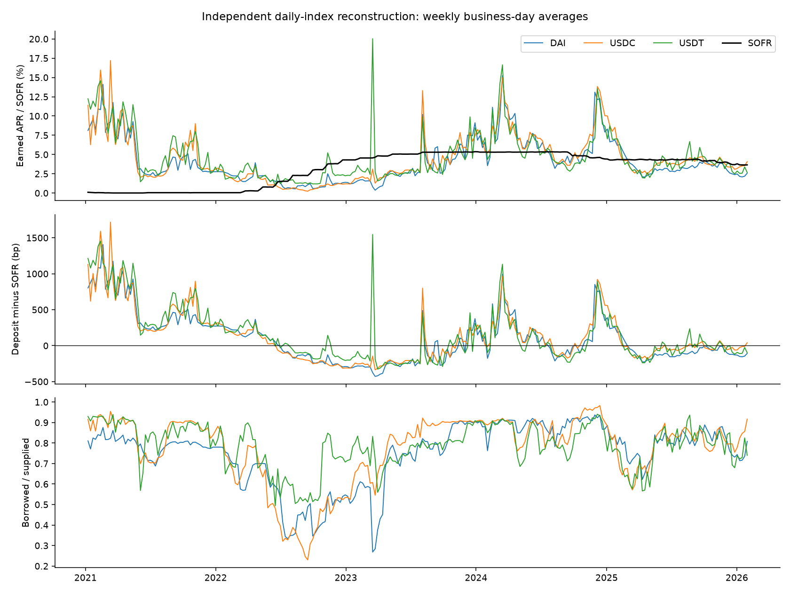
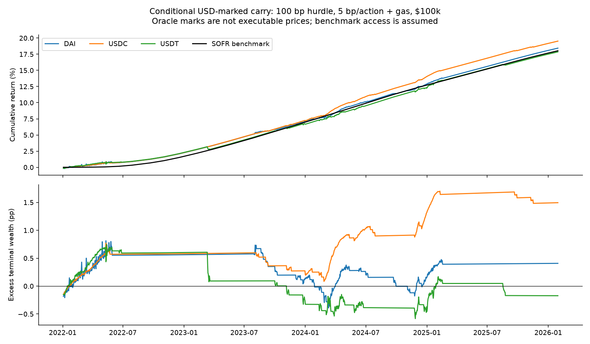
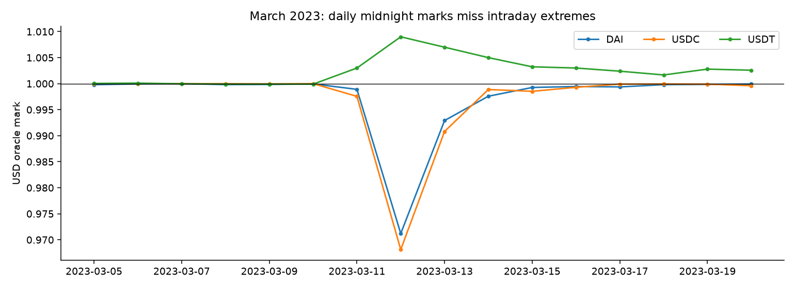

# rate-spread-replication

Status: draft. Set `status: final` in the frontmatter when done; the folder is frozen from then on
(`just check` refuses later edits) and a follow-up is a new experiment with `parent: rate-spread-replication`.

## Hypothesis

Stablecoin deposit spreads to SOFR have predictable persistence or reversal, with implementation costs determining conditional carry outcomes.

Evidence rendered verbatim from `outputs/report.md`; source tables and machine-readable metrics remain under `outputs/`.

## Scope and data integrity

Independent reconstruction of deposit/supply rates, not an exact replication of the paper's Aavescan series. The sample and protocol splice follow the paper; the observations come from public Ethereum archive calls and the official New York Fed API. No paid analytics data, wallet histories or full blocks were retained on the server.

| Dataset | Rows | Parquet bytes |
| --- | --- | --- |
| aave_reserve_daily | 5571 | 1172496 |
| usd_reference_rates | 2548 | 15009 |

Total Parquet storage: 1,187,505 bytes, plus small README/provenance objects. Independent RPC checks cover 6 dates, including the protocol splice, depeg and stable-debt deprecation. Both providers agree on block hashes, reserves, exact indices, balances and oracle returns. Every date has a validated midnight block bracket. Inputs are SHA-256 pinned in config.yaml; scratch retention remains unresolved until owner-reviewed promotion.

| Coin | Days | Missing marks | Marks >48h | Max cutoff gap (s) | Min daily USD mark |
| --- | --- | --- | --- | --- | --- |
| DAI | 1853 | 0 | 0 | 107.0000 | 0.9712 |
| USDC | 1853 | 45 | 0 | 107.0000 | 0.9681 |
| USDT | 1853 | 45 | 0 | 107.0000 | 0.9973 |

Missing early oracle marks remain missing. Trading starts later than the descriptive sample. Daily midnight oracle prices neither establish executable prices nor capture intraday depeg extremes. Current-vintage reference-rate revisions are retained; a historical first-release vintage is unavailable.

## Mechanisms and testable hypotheses

The paper describes segmented capital, overcollateralization and operational costs that can impede equalization of on-chain and off-chain rates. Aave rates also respond mechanically to reserve utilization. Off-chain yields can change depositors' opportunity cost while crypto demand changes borrowing demand. These are competing mechanisms, not an established causal explanation for this reconstructed sample. H1 tests spread reversal; H2 measures utilization/BTC associations; H3 tests sequential forecasting; H4 evaluates conditional unlevered carry; H5 reports borrowing-cost comparisons. Monetary-shock VARs, wallet-level differences-in-differences and intraday event studies are outside this reconstruction.

| Coin | Mean spread (bp) | Below SOFR (%) | Rate-change/BTC corr. | Rate/utilization-change corr. | Variable borrow below SOFR (%) |
| --- | --- | --- | --- | --- | --- |
| DAI | 91.9329 | 50.7825 | 0.1749 | 0.3824 | 23.4754 |
| USDC | 117.9824 | 47.4906 | 0.2586 | 0.4231 | 25.0405 |
| USDT | 143.2470 | 48.7318 | 0.1514 | 0.4838 | 23.2596 |

Borrow comparisons use variable-debt index growth. They are not funded-arbitrage returns: collateral capital, haircuts, liquidation, funding access and all implementation costs would still need to be modeled.

## Paper comparison and sample sensitivity

Realized daily deposit APR comes from normalized income-index ratios within each protocol. Business-day observations are averaged into complete Friday-ending weeks. The ECM regresses weekly spread changes on the previous spread, contemporaneous BTC log change and lagged spread changes; BIC selects from zero through eight lags on a common sample, then the selected model is refit with HAC bandwidth four. These choices are explicit reconstruction conventions: the paper does not specify the exact candidate range and HAC bandwidth. AR(1) half-lives are separate estimates, not transformations of the ECM coefficient.

| Coin | Paper beta | Reconstructed beta | HAC SE | Paper half-life (weeks) | Reconstructed half-life | Paper n | Reconstructed n | Chosen lags |
| --- | --- | --- | --- | --- | --- | --- | --- | --- |
| DAI | -0.1060 | -0.0641 | 0.0249 | 5.0000 | 6.9445 | 259 | 261 | 3 |
| USDC | -0.1330 | -0.0810 | 0.0295 | 4.0000 | 5.1428 | 259 | 260 | 4 |
| USDT | -0.1860 | -0.1271 | 0.0442 | 2.2000 | 3.3516 | 260 | 262 | 2 |

| Excluding 2021 | Beta | 95% CI low | 95% CI high | Half-life (weeks) |
| --- | --- | --- | --- | --- |
| DAI | -0.1526 | -0.2329 | -0.0723 | 3.9915 |
| USDC | -0.1085 | -0.2092 | -0.0078 | 4.8638 |
| USDT | -0.3061 | -0.5439 | -0.0684 | 1.3130 |

| Full sample | ECM level HAC p | Spread ADF p | Engle-Granger p |
| --- | --- | --- | --- |
| DAI | 0.0100 | 0.0946 | 0.2386 |
| USDC | 0.0060 | 0.0319 | 0.0033 |
| USDT | 0.0040 | 0.0048 | 0.0043 |

The ADF null is a unit root; the Engle-Granger null is no cointegration. These tests answer different questions from the conditional ECM coefficient and are shown without treating one test as a substitute for another. UTC sampling, vendor construction and lag choices can contribute to replication differences; their separate effects have not been identified.

## Sequential forecast evidence

Expanding-window AR(1) forecasts use only earlier weekly observations and are compared with no change. The first training window contains 52 weeks. Positive MSE skill means lower squared error than the benchmark. This is pseudo-out-of-sample evaluation: the paper and historical period were already known when the experiment was designed. No multiple-testing correction or untouched holdout is claimed.

| Coin | Forecasts | AR1 RMSE (pp) | No-change RMSE (pp) | MSE skill | Loss-difference HAC p |
| --- | --- | --- | --- | --- | --- |
| DAI | 212 | 1.3240 | 1.3453 | 0.0314 | 0.1432 |
| USDC | 212 | 1.2795 | 1.2344 | -0.0743 | 0.2856 |
| USDT | 212 | 2.1808 | 2.2656 | 0.0734 | 0.1392 |

## Conditional trading performance

The baseline starts 2022-01-03 and ends 2026-01-30, rebalances Mondays using the previous day's headline deposit-minus-known-SOFR spread, and enters above 100 bp. Capital is $100,000 per coin. Each action costs 5 bp plus 300,000 gas at historical base fee plus 2 gwei; entry, exit and protocol migration are charged. Holdings earn exact index growth, marked with the next daily oracle observation. Idle capital earns SOFR on ACT/360; on-chain APR descriptions use ACT/365. SOFR signals become available conservatively after the following publication-day proxy. Reserve flags, supply caps and daily withdrawal liquidity are checked; these do not prove a transaction would fill.

| Coin | Net total (%) | SOFR total (%) | Excess wealth (pp) | Net CAGR (%) | Daily max DD (%) | Actions | Invested (%) |
| --- | --- | --- | --- | --- | --- | --- | --- |
| DAI | 18.4396 | 18.0320 | 0.4076 | 4.2357 | -0.3036 | 34 | 26.7965 |
| USDC | 19.5266 | 18.0320 | 1.4946 | 4.4694 | -0.1714 | 26 | 27.7367 |
| USDT | 17.8592 | 18.0320 | -0.1727 | 4.1102 | -0.4498 | 26 | 23.0356 |

SOFR access, conversion at oracle marks, gas units and non-gas costs are scenario assumptions. There are no transaction-level execution quotes, collateralized financing returns or estimated smart-contract/default loss probabilities. Daily checks omit intraday liquidity changes and v2 global-pause status. The strategy is a separate carry rule; it does not trade the estimated ECM coefficient.

| Coin | Constant-peg total return (%) | USD-marked total return (%) | Max share of supplied tokens (%) |
| --- | --- | --- | --- |
| DAI | 18.3588 | 18.4396 | 0.1300 |
| USDC | 19.4412 | 19.5266 | 0.0303 |
| USDT | 18.9196 | 17.8592 | 0.0383 |

Constant-peg returns retain costs but set conversion marks to par; this is an attribution scenario, not a dollar-return observation. The paper's fixed protocol migration is used for comparability, not claimed as a decision specified prospectively in that historical period.

## Cost and scale sensitivity

The table keeps the same 100 bp hurdle and varies capital and per-action non-gas costs. All configured hurdle/cost/size combinations are retained in outputs/tables/scenarios.csv; none is selected as an optimal strategy.

| Coin | Capital ($) | Cost/action (bp) | Excess wealth (pp) |
| --- | --- | --- | --- |
| DAI | 10000.0000 | 0.0000 | -3.1701 |
| DAI | 100000.0000 | 0.0000 | 2.4434 |
| DAI | 1000000.0000 | 0.0000 | 3.0047 |
| DAI | 10000.0000 | 5.0000 | -5.1515 |
| DAI | 100000.0000 | 5.0000 | 0.4076 |
| DAI | 1000000.0000 | 5.0000 | 0.9636 |
| DAI | 10000.0000 | 25.0000 | -12.7551 |
| DAI | 100000.0000 | 25.0000 | -7.4070 |
| DAI | 1000000.0000 | 25.0000 | -6.8722 |
| USDC | 10000.0000 | 0.0000 | -0.5854 |
| USDC | 100000.0000 | 0.0000 | 3.0606 |
| USDC | 1000000.0000 | 0.0000 | 3.4253 |
| USDC | 10000.0000 | 5.0000 | -2.1190 |
| USDC | 100000.0000 | 5.0000 | 1.4946 |
| USDC | 1000000.0000 | 5.0000 | 1.8560 |
| USDC | 10000.0000 | 25.0000 | -8.0643 |
| USDC | 100000.0000 | 25.0000 | -4.5771 |
| USDC | 1000000.0000 | 25.0000 | -4.2284 |
| USDT | 10000.0000 | 0.0000 | -3.0022 |
| USDT | 100000.0000 | 0.0000 | 1.3722 |
| USDT | 1000000.0000 | 0.0000 | 1.8097 |
| USDT | 10000.0000 | 5.0000 | -4.5119 |
| USDT | 100000.0000 | 5.0000 | -0.1727 |
| USDT | 1000000.0000 | 5.0000 | 0.2612 |
| USDT | 10000.0000 | 25.0000 | -10.3642 |
| USDT | 100000.0000 | 25.0000 | -6.1627 |
| USDT | 1000000.0000 | 25.0000 | -5.7426 |

## Benchmarks, uncertainty and stress

Frictionless uses the same switching rule with zero gas and zero non-gas costs. Hold uses continuous deposit exposure subject to observed entry constraints and the baseline costs.

| Coin | Scenario | Total return (%) | Excess wealth (pp) |
| --- | --- | --- | --- |
| DAI | frictionless | 21.0991 | 3.0671 |
| DAI | hold | 16.4815 | -1.5504 |
| USDC | frictionless | 21.4977 | 3.4658 |
| USDC | hold | 17.6196 | -0.4124 |
| USDT | frictionless | 19.8902 | 1.8583 |
| USDT | hold | 17.9672 | -0.0647 |

| Coin | Annual mean daily excess (%) | Block-bootstrap CI low | CI high |
| --- | --- | --- | --- |
| DAI | 0.0860 | -0.2755 | 0.4557 |
| USDC | 0.3088 | -0.0561 | 0.6744 |
| USDT | -0.0349 | -0.4012 | 0.2960 |

Bootstrap intervals resample 28-day blocks with 1,000 draws and seed 3280; they do not capture unobserved disasters or model-selection uncertainty. Historical chronological splits are descriptive, not independent validation.

| Coin | Period | Net (%) | SOFR (%) | Days >1% supply |
| --- | --- | --- | --- | --- |
| DAI | before_split | 7.0994 | 6.9774 | 0 |
| DAI | after_split | 10.5885 | 10.3336 | 0 |
| USDC | before_split | 7.2502 | 6.9774 | 0 |
| USDC | after_split | 11.4465 | 10.3336 | 0 |
| USDT | before_split | 6.7141 | 6.9774 | 0 |
| USDT | after_split | 10.4439 | 10.3336 | 0 |

| Coin | Hypothetical terminal loss (%) | Remaining excess (pp) |
| --- | --- | --- |
| DAI | 1 | -0.7768 |
| DAI | 5 | -5.5143 |
| DAI | 10 | -11.4363 |
| USDC | 1 | 0.2993 |
| USDC | 5 | -4.4817 |
| USDC | 10 | -10.4580 |
| USDT | 1 | -1.3513 |
| USDT | 5 | -6.0657 |
| USDT | 10 | -11.9587 |

Terminal haircuts are arithmetic stress scenarios with no assigned probability. They are not event-timed loss simulations.

## Reproduction and further experiments

Run acquire.py, validate_acquisition.py and publish_inputs.py in order for a new acquisition; published objects are write-once. With the pinned snapshot available, run `uv run --extra ml python research/defi-repo/experiments/2026-11-03-rate-spread-replication/run.py`, then report.py. The notebook writes full daily, weekly, forecast, scenario and accounting tables plus figures. Synthetic invariants check two-sided costs, terminal liquidation, migration costs, accounting reconciliation, index precision and future-data perturbation.

Next experiments could replace oracle marks with independently licensed executable conversion data; model actual borrowing access and collateral economics; obtain the paper's exact daily vendor series and estimation code for residual reconciliation; replicate its policy-shock design; and preregister a forward evaluation. These are research proposals, not investment recommendations. No keep/park/kill decision is assigned.

## Attribution

Source: ECB WP3280 (paper Table 1); public Ethereum Aave/Chainlink contract state via Alchemy, checked against dRPC; New York Fed SOFR/EFFR API. The SOFR and EFFR data are subject to the Terms of Use posted at newyorkfed.org. The New York Fed is not responsible for publication of these data by semi-systematic, does not endorse this republication, and has no liability for your use. semi-systematic is not affiliated with the New York Fed. The New York Fed does not sanction, endorse, or recommend any products or services offered by semi-systematic.

## Figures

## Review status

Investment decision reserved for the user. Retention requests are prepared; data-layer owner review is required before promotion. The experiment remains draft until its pinned inputs have durable retention.
